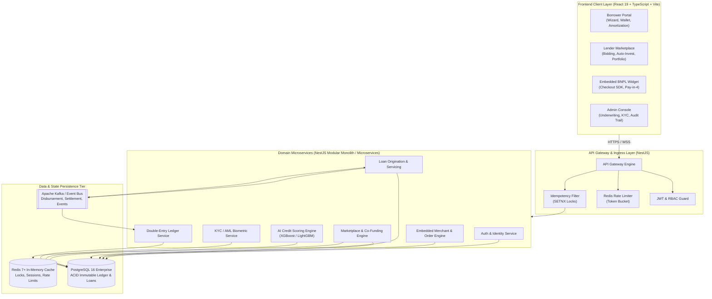
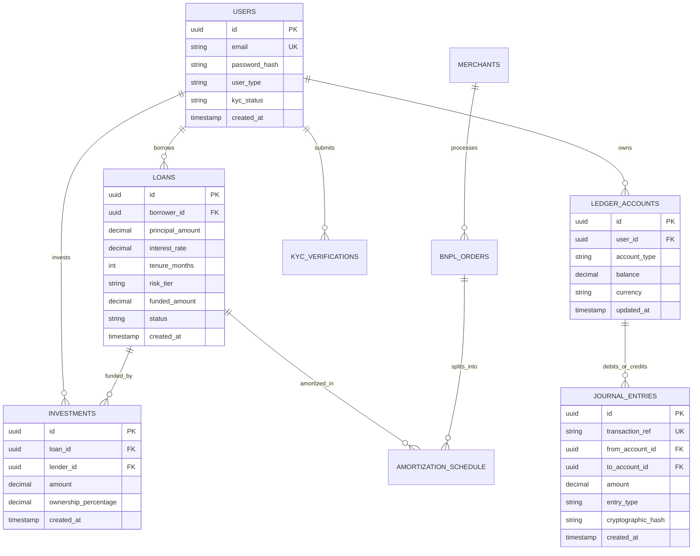
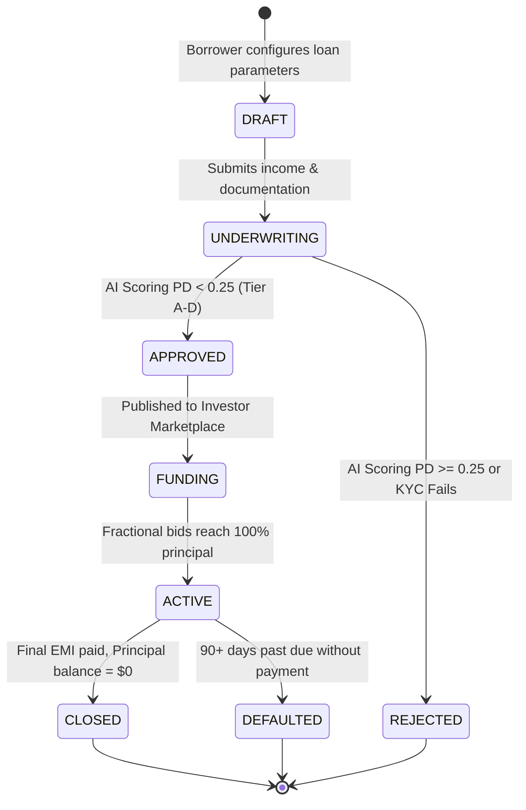
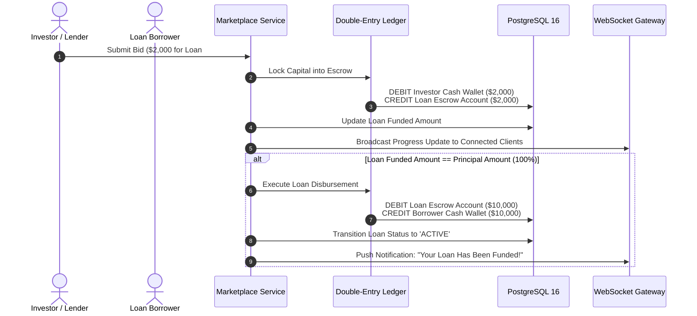
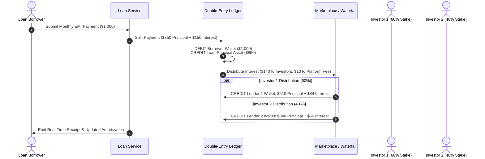

# 🏦 Digital Lending & Embedded Finance Platform
## Complete Technical Architecture, System Specifications & Functional Manual

---

## 📑 Table of Contents

1. [Executive Summary & Project Mission](#1-executive-summary--project-mission)
2. [The Problem Statement: Why We Need This Platform](#2-the-problem-statement-why-we-need-this-platform)
   - 2.1 The Friction of Traditional Banking
   - 2.2 The "Credit-Invisible" Dilemma & Financial Exclusion
   - 2.3 E-Commerce Cart Abandonment & Checkout Friction
   - 2.4 Lack of Retail Investor Access to Fixed-Income Credit
   - 2.5 Accounting Fragility & Auditing Deficits in Modern Fintech
3. [What is the Use of This Platform? (Core Capabilities)](#3-what-is-the-use-of-this-platform-core-capabilities)
   - 3.1 For Borrowers
   - 3.2 For Lenders & Institutional Capital Providers
   - 3.3 For Merchants & Embedded Finance Partners
   - 3.4 For Risk Officers, Underwriters & Regulators
4. [Why This Solution is Necessary](#4-why-this-solution-is-necessary)
   - 4.1 Guaranteed Mathematical Balance via Double-Entry Accounting
   - 4.2 Regulatory Compliance & Explainable AI (SHAP / FCRA)
   - 4.3 High-Throughput Idempotency & Concurrency Guarantees
   - 4.4 Automated Co-Funding & Trustless Escrow Pools
5. [End-to-End System Architecture](#5-end-to-end-system-architecture)
   - 5.1 High-Level Topology & Data Flow Diagram
   - 5.2 Microservice & Module Boundary Definitions
   - 5.3 Complete Production Technology Stack
6. [Detailed Feature Breakdown: How Every Component Works](#6-detailed-feature-breakdown-how-every-component-works)
   - 6.1 Feature 1: Authentication & Role-Based Access Control (RBAC)
   - 6.2 Feature 2: Automated KYC / AML Identity & Biometric Verification
   - 6.3 Feature 3: AI-Powered Credit Scoring Engine & SHAP Explainability
   - 6.4 Feature 4: Borrower Portal & Loan Origination Engine
   - 6.5 Feature 5: Lender & Investor Marketplace with Auto-Invest Rule Engine
   - 6.6 Feature 6: Immutable Double-Entry Financial Ledger
   - 6.7 Feature 7: Embedded Buy-Now-Pay-Later (BNPL) & Checkout SDK
   - 6.8 Feature 8: Admin & Compliance Command Center
   - 6.9 Feature 9: Real-Time Event Streaming & WebSocket Notification Engine
   - 6.10 Feature 10: Idempotency, Concurrency Control & Outbox Pattern
7. [Relational Database Schema & Data Models](#7-relational-database-schema--data-models)
   - 7.1 Entity-Relationship (ER) Diagram
   - 7.2 Core PostgreSQL Schema Definitions
8. [Financial Lifecycles & State Machine Transitions](#8-financial-lifecycles--state-machine-transitions)
   - 8.1 Loan Origination & Funding State Machine
   - 8.2 Escrow Locking & Disbursement Sequence
   - 8.3 Repayment, Waterfall Amortization & Yield Distribution
9. [Security, Zero-Trust Infrastructure & Compliance](#9-security-zero-trust-infrastructure--compliance)
10. [Deployment & Infrastructure Topology](#10-deployment--infrastructure-topology)

---

## 1. Executive Summary & Project Mission

The **Digital Lending & Embedded Finance Platform** is an enterprise-grade, cloud-native financial ecosystem designed to solve the structural bottlenecks of modern credit origination, capital allocation, and embedded payments.

By combining:
- **Instant algorithmic underwriting** (powered by machine learning and alternative data ingestion),
- **Fractionalized peer-to-peer (P2P) / marketplace lending**,
- **Point-of-Sale Buy-Now-Pay-Later (BNPL) widgets**, and
- **An immutable, double-entry financial general ledger**,

the platform collapses loan origination times from **weeks to seconds**, eliminates intermediary overhead, provides credit access to underserved demographics, and maintains an audit-proof, cryptographically traceable ledger for every cent transacted.

---

## 2. The Problem Statement: Why We Need This Platform

### 2.1 The Friction of Traditional Banking
Traditional banks and legacy lending institutions rely on manual paperwork, physical branch verification, legacy mainframe credit scoring, and multi-day committee approvals. 
- **Time-to-Cash**: Standard unsecured personal or SME loans take **5 to 21 business days** from application to disbursement.
- **High Operational Costs**: Human underwriters, physical document couriers, and legacy branch networks inflate origination fees up to 5–8% of the loan principal.
- **Poor Customer Experience**: Inflexible loan terms, lack of transparent tracking, and punitive early-repayment penalties discourage modern digital-first consumers.

### 2.2 The "Credit-Invisible" Dilemma & Financial Exclusion
Over **1.4 billion adults globally** lack access to formal credit because legacy bureaus (e.g., FICO, Experian) rely exclusively on traditional banking footprints, past credit card history, and mortgage records. 
- Young professionals, gig-economy workers, freelancers, and small business owners are routinely rejected despite earning healthy cashflows.
- Legacy models fail to ingest **alternative data streams**—such as utility bill payment consistency, telecom airtime recharges, e-wallet velocity, and point-of-sale invoice turnover.

### 2.3 E-Commerce Cart Abandonment & Checkout Friction
E-commerce merchants experience average cart abandonment rates hovering between **68% and 75%**, largely driven by upfront price friction on high-ticket goods ($200–$3,000). 
- Traditional credit cards charge 20–30% APR, require separate application processes, and penalize consumers with opaque compound interest.
- Merchants lack simple, embedded checkout SDKs that allow instant point-of-sale installment split payments with sub-second approval.

### 2.4 Lack of Retail Investor Access to Fixed-Income Credit
In a volatile macro environment, retail and high-net-worth investors are largely locked out of private credit markets—an asset class dominated by commercial banks and private equity firms earning 10–18% net annualized yields. 
- Retail investors are stuck with low-yield bank deposits or volatile equity markets.
- They lack a transparent, risk-stratified marketplace where they can co-fund pre-vetted loans, set automated portfolio-allocation rules, and earn monthly automated cashflows.

### 2.5 Accounting Fragility & Auditing Deficits in Modern Fintech
Many modern fintech startups track customer balances using simple database counters (`UPDATE accounts SET balance = balance + 100`). 
- This approach is prone to race conditions, silent database corruption, balance drift, and failure during regulatory audits.
- Without a rigorous **double-entry journal system** where every debit has an equal credit, proving balance sheet integrity is impossible.

---

## 3. What is the Use of This Platform? (Core Capabilities)

```
┌─────────────────────────────────────────────────────────────────────────────┐
│             DIGITAL LENDING & EMBEDDED FINANCE PLATFORM                     │
├─────────────────────┬───────────────────────┬───────────────────────────────┤
│   BORROWER PORTAL   │   LENDER MARKETPLACE  │    EMBEDDED BNPL CHECKOUT     │
│ • Instant Loan Flow │ • Fractional Bidding  │ • Split 4-Pay POS Widget      │
│ • Real-time AI Risk │ • Auto-Invest Engine  │ • Merchant Instant Settlement │
│ • Wallet & Auto-EMI │ • Portfolio Analytics │ • Zero-Friction Credit        │
├─────────────────────┴───────────────────────┴───────────────────────────────┤
│                     CORE FINANCIAL INFRASTRUCTURE                           │
│ • Immutable Double-Entry Ledger        • Real-Time WebSocket Telemetry      │
│ • Automated KYC/AML Biometrics         • Redis Distributed Idempotency      │
└─────────────────────────────────────────────────────────────────────────────┘
```

### 3.1 For Borrowers
- **End-to-End Digital Loan Application**: Apply in under 3 minutes with progressive disclosure wizard forms.
- **Instant Risk Assessment**: Instant algorithmic approval, transparent risk tier assignment (A through D), and competitive interest rates.
- **Dynamic Amortization & Repayment Dashboard**: Interactive visualization of principal vs. interest breakdown over time, with one-click early repayment or automated EMI scheduled debits.
- **Integrated Digital Cash Wallet**: Real-time balance management with instant deposit, withdrawal, and audit history.

### 3.2 For Lenders & Institutional Capital Providers
- **Fractionalized Loan Marketplace**: Browse vetted borrowers, examine debt-to-income (DTI) metrics, employment profiles, and credit risk classifications.
- **Portfolio Diversification**: Invest as little as $100 across dozens of loans to diversify risk exposure.
- **Algorithmic Auto-Invest Rules**: Define automated bidding strategies based on minimum yield (APR), maximum loan exposure, credit tier preferences, and tenure constraints.
- **Predictable Monthly Cashflows**: Receive automatic monthly principal and interest distributions credited directly into the investor wallet as borrowers repay.

### 3.3 For Merchants & Embedded Finance Partners
- **Drop-in Checkout SDK**: Integrate a Pay-in-4 or 6-month installment widget directly into e-commerce checkout funnels via simple API/SDK integrations.
- **Higher Average Order Value (AOV)**: Increase conversion rates by 20–40% and boost basket sizes by eliminating upfront payment friction.
- **Zero Merchant Credit Risk**: The platform funds the merchant immediately upon order confirmation; all consumer underwriting, repayment collection, and default risks are assumed by the platform and investors.

### 3.4 For Risk Officers, Underwriters & Regulators
- **Explainable AI (XAI) Underwriting Console**: Inspect machine learning decisioning via SHAP (Shapley Additive Explanations) force plots to understand exactly *why* an applicant was approved, tiered, or rejected.
- **Live KYC / AML Review Queue**: Review automated biometric verification scores, OCR-extracted government ID data, and real-time AML sanctions/PEP screening matches.
- **Cryptographic Audit Trail**: Every administrative action, balance transfer, and loan transition is recorded in a tamper-evident, append-only log hashed with SHA-256.

---

## 4. Why This Solution is Necessary

| Core Challenge | Legacy Approach | This Platform's Engineering Solution |
| :--- | :--- | :--- |
| **Financial Balance Integrity** | Single-column balances (`user.balance += amount`) prone to balance drift and double-spend race conditions. | **Strict Double-Entry General Ledger**: Every transaction requires paired `DEBIT` and `CREDIT` entries. `SUM(Debits) == SUM(Credits)` enforced by DB constraints. |
| **Underwriting Speed & Fairness** | Manual credit officer review taking 5–14 days, often biased or relying on stale credit bureau files. | **Real-Time ML Pipeline**: Gradient boosted decision trees evaluate 40+ alternative data points in <300ms, outputting SHAP feature explanations for regulatory compliance. |
| **Transaction Safety & Retries** | Network timeouts cause users to click "Pay" twice, leading to duplicate disbursements or double debits. | **Redis-Backed Idempotency Engine**: All state-mutating requests mandate an `Idempotency-Key` header with TTL locks, safely returning existing results on retries. |
| **Capital Allocation Efficiency** | Banks warehouse loans on balance sheets, taking months to syndicate debt packages. | **Real-Time P2P Matching & Escrow**: Borrowers publish requests; multiple investors co-fund loans in fractional tranches held in atomic escrow accounts. |
| **Compliance & Auditing** | Disconnected paper records and manual spreadsheets during regulatory inquiries (SOC2, PCI-DSS). | **Immutable Audit Logs**: Append-only telemetry stamped with actor ID, IP address, timestamp, payload, and cryptographic signature. |

---

## 5. End-to-End System Architecture

### 5.1 High-Level Topology & Data Flow Diagram



### 5.2 Microservice & Module Boundary Definitions

1. **Authentication & Identity Service**: Handles multi-tenant authentication, password hashing (bcrypt), JWT generation with short lifespans (15m access / 7d refresh), and Role-Based Access Control (RBAC) across `BORROWER`, `LENDER`, `MERCHANT`, and `ADMIN`.
2. **KYC / AML Compliance Service**: Manages document verification workflows (Passport, National ID, Driver's License), facial biometric match score evaluation, and watchlist screening (PEP / Sanctions).
3. **Credit Scoring & Underwriting Service**: Evaluates applicant attributes, financial metrics, and alternative data using an ensemble of decision trees, generating calibrated Default Probabilities (PD), Risk Tiers (`A`, `B`, `C`, `D`), and SHAP feature importance vectors.
4. **Loan Origination Service**: Controls the lifecycle state machine from `DRAFT` → `SUBMITTED` → `UNDERWRITING` → `APPROVED` → `FUNDING` → `ACTIVE` → `CLOSED` / `DEFAULTED`.
5. **Marketplace & Co-Funding Service**: Powers real-time fractional bids from multiple investors, tracks funding progress bars, handles Auto-Invest automated execution, and transitions loans to `ACTIVE` once 100% funded.
6. **Double-Entry Financial Ledger Service**: Manages the Chart of Accounts (`CASH_WALLET`, `ESCROW`, `LOAN_PRINCIPAL`, `INTEREST_REVENUE`, `PLATFORM_FEE`), executes atomic journal entries, and enforces mathematical balance invariance.
7. **Embedded BNPL Service**: Generates merchant API keys, manages merchant checkout sessions, calculates split 4-pay amortization schedules, and coordinates merchant settlement.

### 5.3 Complete Production Technology Stack

| Architecture Layer | Technology | Version | Purpose in Platform |
| :--- | :--- | :--- | :--- |
| **Frontend Framework** | React + TypeScript | v19.x | Component-driven UI, zero runtime type errors, fast state transitions |
| **Build Tooling** | Vite | v8.x | Lightning-fast HMR, optimized tree-shaken production bundles |
| **State Management** | Redux Toolkit | v2.x | Centralized global store for Auth tokens, user profiles, and active sessions |
| **Server State & Cache**| TanStack React Query | v5.x | Optimistic UI updates, caching, automatic query refetching |
| **Financial Visuals** | Recharts | v3.x | Area charts for amortizations, bar charts for risk distribution & SHAP weights |
| **Design System** | Vanilla CSS + Design Tokens | Custom | Bespoke fintech aesthetic, glassmorphic dark mode, micro-interactions |
| **Backend Framework** | NestJS / Node.js | v10+ / v20 LTS | Enterprise modular architecture, dependency injection, high concurrency |
| **Database Tier** | PostgreSQL | v16+ | ACID transactions, serializable isolation for ledger entries, UUID keys |
| **Cache & Locks** | Redis | v7.x | Idempotency locks, token-bucket rate limiting, fast session validation |
| **Message Broker** | Apache Kafka / RabbitMQ | Latest | Asynchronous event streaming, decoupled payouts, resilient settlement |
| **Validation & Schema**| Zod + class-validator | Latest | End-to-end schema validation from client forms to database DTOs |

---

## 6. Detailed Feature Breakdown: How Every Component Works

### 6.1 Feature 1: Authentication & Role-Based Access Control (RBAC)

#### How It Works:
1. **Registration & Role Assignment**: A user signs up specifying their role (`BORROWER`, `LENDER`, `MERCHANT`, or `ADMIN`).
2. **Password Security**: Passwords undergo salted bcrypt hashing (cost factor 12).
3. **Dual-Token Handshake**:
   - On successful authentication, the server emits a short-lived Access Token (JWT, 15-minute expiration) and an HTTP-only Refresh Token (7-day expiration).
   - The frontend Axios interceptor intercepts outgoing requests to inject `Authorization: Bearer <token>`.
   - On encountering a `401 Unauthorized`, the interceptor queues pending requests, requests a fresh token pair via `/auth/refresh`, and transparently replays the queued requests.
4. **Role Guards**: Backend endpoints enforce `@Roles(Role.ADMIN)` decorators; frontend routes are guarded by high-order `<ProtectedRoute requiredRole="..." />` components.

---

### 6.2 Feature 2: Automated KYC / AML Identity & Biometric Verification

#### How It Works:
```
Applicant Uploads ID & Selfie ──► OCR Document Parsing ──► Biometric Facial Comparison
                                                                  │
                                      ┌───────────────────────────┴───────────────────────────┐
                                      ▼                                                       ▼
                             Match Score >= 85%                                      Match Score < 85%
                                      │                                                       │
                           PEP & Sanctions Screening                               Auto-Routed to Admin
                                      │                                              Manual Review Queue
                                      ▼
                        Status: VERIFIED (Borrowing Unlocked)
```
1. **Document Intake**: The borrower uploads a front/back photo of an official ID (Passport, Driving License, or National Identity Card) along with a live video selfie.
2. **Biometric Liveness & Facial Matching**: Algorithms verify facial landmark parity between the document photo and the live capture, generating a `biometricScore` (0–100%).
3. **Anti-Money Laundering (AML) Screening**: The applicant's name and identification number are screened against global databases:
   - OFAC (Office of Foreign Assets Control)
   - Interpol Watchlists
   - PEP (Politically Exposed Persons) databases
4. **Automated Triage**:
   - `CLEAN` + `Score >= 85%`: Instant automated status upgrade to `VERIFIED`.
   - `FLAGGED_PEP` or `Score < 85%`: Marked `PENDING_REVIEW` and routed to the **Admin Compliance Suite**.

---

### 6.3 Feature 3: AI-Powered Credit Scoring Engine & SHAP Explainability

#### How It Works:
Traditional credit checks fail because they depend on single-source FICO scores. This platform utilizes an **XGBoost gradient boosting ensemble** trained on historical performance across traditional and non-traditional features:

```
[ Traditional Bureau Data ] \
[ Monthly Net Cashflow    ]  \
[ Debt-to-Income (DTI)    ]   ──► [ XGBoost Feature Pipeline ] ──► [ Calibrated Default Probability ]
[ Telecom Top-up Velocity ]  /                                                │
[ E-Commerce Pay History  ] /                                                 ├── Tier A: 5.0% - 8.0%  APR
                                                                              ├── Tier B: 8.5% - 12.0% APR
                                                                              ├── Tier C: 12.5% - 16.0% APR
                                                                              └── Tier D: 16.5% - 22.0% APR
```

1. **Feature Transformation**: Ingests DTI ratio, declared income, employment tenure, payment punctuality metrics, and utility bill histories.
2. **Scoring & Risk Tiering**:
   - Probability of Default (PD) calculated between `0.00` and `1.00`.
   - Applicants mapped into standardized risk brackets: **Tier A** (Super-Prime), **Tier B** (Prime), **Tier C** (Near-Prime), and **Tier D** (Sub-Prime).
3. **Regulatory Explainability (SHAP Values)**:
   - To satisfy the **Fair Credit Reporting Act (FCRA)** and **Equal Credit Opportunity Act (ECOA)**, the engine computes Shapley Additive Explanations.
   - Every score is accompanied by quantitative feature contribution weights (e.g., `Debt-to-Income Ratio: -0.42`, `Income Stability: +0.28`).
   - These are rendered in real time on the Admin Underwriting Dashboard so loan officers can provide explicit, lawful adverse action notices if a loan is denied.

---

### 6.4 Feature 4: Borrower Portal & Loan Origination Engine

#### How It Works:
1. **Multi-Step Application Wizard**:
   - **Step 1: Loan Configuration**: Select loan purpose (Debt Consolidation, Business Expansion, Medical, Home Improvement), principal amount ($1,000 to $100,000), and tenure (6, 12, 24, 36 months).
   - **Step 2: Financial Profile**: Monthly income, housing status, employment verification, and employer name.
   - **Step 3: Document Upload**: Paystubs, bank statements, tax returns.
   - **Step 4: AI Underwriting Review**: Real-time animated calculation displaying the dynamic interest rate, estimated monthly EMI, and instant loan decision.
2. **Interactive Amortization Engine**:
   - Uses the standard annuity amortization formula:
     $$\text{EMI} = P \times \frac{r(1+r)^n}{(1+r)^n - 1}$$
     *(where $P$ is principal, $r$ is monthly interest rate, and $n$ is total tenure months).*
   - Renders interactive stacked area charts in the borrower portal displaying the diminishing interest component and accelerating principal amortization over time.
3. **Repayment & Digital Wallet**:
   - Borrowers can fund their integrated wallet via mock ACH/card transfer and click **"Pay EMI"** to settle scheduled installments.
   - Early repayments automatically recalculate remaining balances without penalty.

---

### 6.5 Feature 5: Lender & Investor Marketplace with Auto-Invest Rule Engine

#### How It Works:
```
           ┌────────────────────────────────────────────────────────┐
           │              LENDER MARKETPLACE POOL                   │
           └──────────────────────────┬─────────────────────────────┘
                                      │
              ┌───────────────────────┴───────────────────────┐
              ▼                                               ▼
     [ MANUAL BIDDING ]                              [ AUTO-INVEST ENGINE ]
  Investor reviews loan DTI,                      Runs background scan matching
  purpose & SHAP insights;                        rules: Min Yield >= 10%,
  commits fractional $500.                        Max Per Loan <= $1,000.
              │                                               │
              └───────────────────────┬───────────────────────┘
                                      │
                                      ▼
                      Atomic Ledger Debit to ESCROW
                                      │
                          Loan hits 100% Funded
                                      │
                          Disbursed to Borrower
```

1. **Fractional Co-Funding**:
   - A $20,000 loan request is published to the marketplace.
   - Multiple independent lenders commit portions (e.g., Lender 1: $1,000; Lender 2: $5,000; Lender 3: $500).
   - Committed capital is instantly locked in an immutable **Escrow Account** via double-entry journal entries.
2. **Auto-Invest Strategy Engine**:
   - Investors can toggle an automated investing bot with custom constraints:
     - Minimum Target Net Yield (e.g., $\ge 9.5\%$ APR)
     - Maximum Investment per Single Loan (e.g., $\$500$ or $10\%$ of loan principal)
     - Eligible Risk Tiers (e.g., Only Tiers `A` and `B`)
     - Maximum Target Tenures (e.g., $\le 24$ months)
   - Whenever an approved loan enters the marketplace, the matching engine executes matching auto-bids in FIFO order.
3. **Automated Yield Waterfall**:
   - When the borrower pays their $\$800$ monthly EMI, the system distributes principal and interest pro-rata to every co-funding investor according to their fractional ownership percentage (less a $1.0\%$ annual platform servicing fee).

---

### 6.6 Feature 6: Immutable Double-Entry Financial Ledger

#### Why It's Unique:
Every financial transaction on the platform is governed by strict financial accounting axioms. **No balance is ever adjusted directly.** Every movement generates a pair of debits and credits in the `journal_entries` table.

```
Example: $5,000 Loan Disbursement to Borrower Wallet
=====================================================
DEBIT:  Lender Escrow Account (Asset Reduction)         $5,000.00
CREDIT: Borrower Cash Wallet (Liability Increase)       $5,000.00
-----------------------------------------------------
NET LEDGER BALANCE CHANGE:                              $0.00 (Balanced)
```

```
Example: $500 Loan Repayment ($450 Principal + $50 Interest)
=====================================================
DEBIT:  Borrower Cash Wallet                            $500.00
CREDIT: Loan Principal Asset Account                    $450.00
CREDIT: Lender Interest Revenue Account                  $45.00
CREDIT: Platform Servicing Fee Revenue Account            $5.00
-----------------------------------------------------
TOTAL DEBITS: $500.00  |  TOTAL CREDITS: $500.00 (Balanced)
```

- **Serializable Transactions**: Handled under PostgreSQL `SERIALIZABLE` or `REPEATABLE READ` transaction isolation to prevent phantom reads and dirty writes.
- **Cryptographic Chaining**: Each journal record includes a SHA-256 hash of `[previous_hash + transaction_ref + amount + timestamp]`, ensuring any direct database tampering is immediately detectable.

---

### 6.7 Feature 7: Embedded Buy-Now-Pay-Later (BNPL) & Checkout SDK

#### How It Works:
The platform exposes an embedded checkout widget designed for seamless integration into merchant e-commerce storefronts.

1. **Merchant Cart Context**:
   - An e-commerce customer reaches checkout with a $1,200 cart (e.g., MacBook, Designer Apparel, Home Gym).
   - The embedded SDK computes an installment schedule: **4 bi-weekly payments of $300.00 (0% APR)** or **6 monthly payments of $215.00**.
2. **Sub-Second Credit Gate**:
   - The customer enters their mobile number and SSN last-4.
   - The platform performs an instant soft-inquiry risk check via the scoring engine in <400ms.
3. **Merchant Settlement & Instant Order Creation**:
   - Upon consumer confirmation, the first 25% installment is charged immediately.
   - The platform creates a guaranteed merchant payable for the full purchase balance (less a 2.9% merchant discount rate).
   - The merchant receives immediate funds, shipping the product with zero credit risk.
4. **Automated Schedule Management**:
   - The remaining 3 installments are scheduled into the double-entry ledger with automated payment capture against the customer's card on Day 14, Day 28, and Day 42.

---

### 6.8 Feature 8: Admin & Compliance Command Center

#### Built-in Management Modules:
1. **Underwriting Console**:
   - View pending loans requiring manual intervention.
   - Inspect the borrower's full profile, declared vs. verified income, credit bureau score, and the model's SHAP feature weights.
   - One-click override buttons (`Approve Loan`, `Reject Application`, `Request Additional Documentation`).
2. **KYC Verification Review Queue**:
   - Side-by-side inspection of uploaded photo IDs and extracted biometric facial captures.
   - Live flag alerts for watchlist matches (PEP, Sanctions, High-Risk Jurisdiction).
   - Manual status overrides with audit remarks.
3. **Platform Analytics & Health Dashboard**:
   - **Origination vs. Funded Volumes**: Time-series area charts monitoring monthly platform throughput.
   - **Capital Exposure by Risk Tier**: Bar charts displaying institutional and retail capital deployed across Tiers A, B, C, and D.
   - **Operational Health Metrics**: Real-time metrics tracking non-performing loan (NPL) ratios, default rates, 30-day delinquency rates, and platform cash reserve requirements.
4. **Tamper-Evident Audit Trail**:
   - Full search, filter, and exportable (CSV/Excel) event logs recording actor emails, user roles, event classifications, IP addresses, and cryptographic hashes.

---

### 6.9 Feature 9: Real-Time Event Streaming & WebSocket Notification Engine

#### How It Works:
Financial platforms require immediate notifications for high-stakes events (e.g., loan funded, margin call, repayment due, disbursement received).
- **Socket.io WebSocket Layer**: Authenticated WebSocket connections established between clients and the API gateway using the user's JWT.
- **Event Broadcaster**:
  - When an investor funds a loan tranche, the loan origination service publishes a `LOAN_FUNDED_PARTIAL` event to Kafka.
  - The notification consumer reads the event and pushes a real-time payload to the borrower's active WebSocket connection, instantly updating the frontend progress bar without page reloads.
  - Push notifications are delivered for `KYC_COMPLETED`, `LOAN_APPROVED`, `EMI_PAID`, and `INVESTMENT_RETURN`.

---

### 6.10 Feature 10: Idempotency, Concurrency Control & Outbox Pattern

#### Financial Safety Mechanisms:
1. **Idempotency-Key Header**:
   - Every mutating endpoint (e.g., `POST /loans`, `POST /marketplace/fund`, `POST /wallet/transfer`) accepts an `Idempotency-Key: <UUID>` header.
   - The NestJS interceptor issues a Redis `SET key value NX EX 120` command.
   - If a duplicate request arrives while the first is processing, the second is blocked. If the first has already completed, Redis immediately returns the cached response, preventing double payments.
2. **Transactional Outbox Pattern**:
   - Database state mutations and corresponding Kafka events are written within the same local PostgreSQL transaction.
   - A dedicated publisher reads pending outbox messages and reliably pushes them to Kafka, ensuring zero message loss even during infrastructure outages.

---

## 7. Relational Database Schema & Data Models

### 7.1 Entity-Relationship (ER) Diagram



### 7.2 Core PostgreSQL Schema Definitions

```sql
-- Extensions
CREATE EXTENSION IF NOT EXISTS "uuid-ossp";
CREATE EXTENSION IF NOT EXISTS "pgcrypto";

-- 1. Users Table
CREATE TABLE users (
    id UUID PRIMARY KEY DEFAULT gen_random_uuid(),
    email VARCHAR(255) UNIQUE NOT NULL,
    password_hash VARCHAR(255) NOT NULL,
    first_name VARCHAR(100) NOT NULL,
    last_name VARCHAR(100) NOT NULL,
    user_type VARCHAR(20) NOT NULL CHECK (user_type IN ('BORROWER', 'LENDER', 'ADMIN', 'MERCHANT')),
    kyc_status VARCHAR(20) DEFAULT 'PENDING' CHECK (kyc_status IN ('PENDING', 'VERIFIED', 'REJECTED')),
    created_at TIMESTAMP WITH TIME ZONE DEFAULT CURRENT_TIMESTAMP,
    updated_at TIMESTAMP WITH TIME ZONE DEFAULT CURRENT_TIMESTAMP
);

-- 2. Loans Table
CREATE TABLE loans (
    id UUID PRIMARY KEY DEFAULT gen_random_uuid(),
    borrower_id UUID NOT NULL REFERENCES users(id) ON DELETE RESTRICT,
    principal_amount DECIMAL(15, 2) NOT NULL CHECK (principal_amount > 0),
    interest_rate DECIMAL(5, 2) NOT NULL CHECK (interest_rate >= 0),
    tenure_months INT NOT NULL CHECK (tenure_months > 0),
    purpose VARCHAR(255) NOT NULL,
    risk_tier VARCHAR(5) NOT NULL CHECK (risk_tier IN ('A', 'B', 'C', 'D')),
    default_probability DECIMAL(5, 4) NOT NULL,
    funded_amount DECIMAL(15, 2) DEFAULT 0.00 CHECK (funded_amount <= principal_amount),
    status VARCHAR(20) DEFAULT 'DRAFT' CHECK (status IN ('DRAFT', 'UNDERWRITING', 'APPROVED', 'FUNDING', 'ACTIVE', 'CLOSED', 'DEFAULTED')),
    created_at TIMESTAMP WITH TIME ZONE DEFAULT CURRENT_TIMESTAMP,
    updated_at TIMESTAMP WITH TIME ZONE DEFAULT CURRENT_TIMESTAMP
);

-- 3. Loan Investments (Marketplace Fractional Co-Funding)
CREATE TABLE loan_investments (
    id UUID PRIMARY KEY DEFAULT gen_random_uuid(),
    loan_id UUID NOT NULL REFERENCES loans(id) ON DELETE RESTRICT,
    lender_id UUID NOT NULL REFERENCES users(id) ON DELETE RESTRICT,
    amount DECIMAL(15, 2) NOT NULL CHECK (amount > 0),
    ownership_percentage DECIMAL(5, 4) NOT NULL CHECK (ownership_percentage > 0 AND ownership_percentage <= 1),
    created_at TIMESTAMP WITH TIME ZONE DEFAULT CURRENT_TIMESTAMP
);

-- 4. Double-Entry Ledger Accounts
CREATE TABLE ledger_accounts (
    id UUID PRIMARY KEY DEFAULT gen_random_uuid(),
    user_id UUID REFERENCES users(id) ON DELETE RESTRICT,
    account_type VARCHAR(50) NOT NULL CHECK (account_type IN ('CASH_WALLET', 'ESCROW', 'LOAN_PRINCIPAL', 'INTEREST_REVENUE', 'PLATFORM_FEE')),
    balance DECIMAL(15, 2) DEFAULT 0.00,
    currency VARCHAR(3) DEFAULT 'USD',
    updated_at TIMESTAMP WITH TIME ZONE DEFAULT CURRENT_TIMESTAMP
);

-- 5. Double-Entry Journal Transactions
CREATE TABLE journal_entries (
    id UUID PRIMARY KEY DEFAULT gen_random_uuid(),
    transaction_ref VARCHAR(100) UNIQUE NOT NULL,
    from_account_id UUID NOT NULL REFERENCES ledger_accounts(id) ON DELETE RESTRICT,
    to_account_id UUID NOT NULL REFERENCES ledger_accounts(id) ON DELETE RESTRICT,
    amount DECIMAL(15, 2) NOT NULL CHECK (amount > 0),
    entry_type VARCHAR(50) NOT NULL CHECK (entry_type IN ('DISBURSEMENT', 'REPAYMENT_PRINCIPAL', 'REPAYMENT_INTEREST', 'ESCROW_LOCK', 'FEE')),
    cryptographic_hash VARCHAR(64) NOT NULL,
    created_at TIMESTAMP WITH TIME ZONE DEFAULT CURRENT_TIMESTAMP
);

-- Indices for Low-Latency Query Execution
CREATE INDEX idx_loans_borrower_status ON loans(borrower_id, status);
CREATE INDEX idx_loans_marketplace ON loans(status, risk_tier) WHERE status = 'FUNDING';
CREATE INDEX idx_journal_accounts ON journal_entries(from_account_id, to_account_id);
CREATE INDEX idx_journal_ref ON journal_entries(transaction_ref);
CREATE INDEX idx_investments_loan ON loan_investments(loan_id);
```

---

## 8. Financial Lifecycles & State Machine Transitions

### 8.1 Loan Origination & Funding State Machine



### 8.2 Escrow Locking & Disbursement Sequence



### 8.3 Repayment, Waterfall Amortization & Yield Distribution



---

## 9. Security, Zero-Trust Infrastructure & Compliance

1. **Defense-in-Depth & Network Isolation**:
   - The PostgreSQL primary database and Redis cache operate in private subnets with no public ingress.
   - All external communication terminates at the API Gateway over **TLS 1.3**.
2. **Field-Level Data Encryption (FLE)**:
   - Sensitive Personally Identifiable Information (SSN, national ID numbers, bank routing codes) is encrypted at rest using **AES-256-GCM** with keys managed via AWS KMS / HashiCorp Vault.
3. **Role-Based Access Control (RBAC)**:
   - Token claims contain granular permission scopes (e.g., `loans:read`, `underwriting:override`, `ledger:audit`).
   - Every request runs through permission interceptors before reaching database handlers.
4. **Regulatory Adherence**:
   - **SOC 2 Type II**: Comprehensive immutable audit logs, strict change management, and automated continuous compliance monitoring.
   - **PCI-DSS Level 1**: Tokenized payment capture through certified payment vaults (Stripe / Plaid), preventing raw credit card data from ever touching platform servers.
   - **FCRA & ECOA**: Enforced explainable AI guarantees; adverse actions are always paired with quantifiable SHAP feature explanations.

---

## 10. Deployment & Infrastructure Topology

```
                                 [ Cloudflare Edge / DDoS Shield ]
                                                │
                                    ┌───────────┴───────────┐
                                    ▼                       ▼
                       [ Vercel Edge Network ]     [ AWS / GCP Ingress ]
                          Frontend React SPA            API Gateway
                                    │                       │
                                    │ HTTPS API Calls       │ Private VPC
                                    └──────────────────────►▼
                                                    [ NestJS Services ]
                                                            │
                                              ┌─────────────┼─────────────┐
                                              ▼             ▼             ▼
                                        [ PostgreSQL ]   [ Redis ]   [ Apache Kafka ]
                                         Multi-AZ ACID  Cache & Lock   Event Stream
```

- **Frontend Deployment (Vercel)**:
  - Global edge CDN distribution with sub-50ms static asset delivery.
  - Automatic preview deployments for pull requests and atomic production rollouts.
  - Zero-configuration HTTPS with automatic TLS certificate renewals.
- **Backend Deployment (Containerized / Kubernetes)**:
  - Packaged via lightweight Docker Alpine images with multi-stage builds.
  - Orchestrated with Kubernetes horizontal pod autoscalers (HPA) scaling on CPU, memory, and Kafka consumer group lag.
  - Health checks (`/health/liveness`, `/health/readiness`) ensuring zero-downtime rolling deployments.

---

*This master document is maintained as the architectural specification and implementation guide for the Digital Lending & Embedded Finance Platform.*
