# 🏦 Digital Lending & Embedded Finance Platform — Detailed Feature Breakdown

> [!IMPORTANT]
> This document is the **master implementation blueprint**. Every feature is traced end-to-end: UI → API → Service → Database → Events. Read this before writing any code.

---

## Table of Contents

1. [Architecture Overview](#1-architecture-overview)
2. [Feature 1 — Authentication & User Management](#2-feature-1--authentication--user-management)
3. [Feature 2 — KYC / AML Identity Verification](#3-feature-2--kyc--aml-identity-verification)
4. [Feature 3 — AI-Powered Credit Scoring Engine](#4-feature-3--ai-powered-credit-scoring-engine)
5. [Feature 4 — Borrower Portal & Loan Origination](#5-feature-4--borrower-portal--loan-origination)
6. [Feature 5 — Lender / Investor Marketplace](#6-feature-5--lender--investor-marketplace)
7. [Feature 6 — Double-Entry Financial Ledger](#7-feature-6--double-entry-financial-ledger)
8. [Feature 7 — Embedded BNPL / Checkout SDK](#8-feature-7--embedded-bnpl--checkout-sdk)
9. [Feature 8 — Admin & Compliance Suite](#9-feature-8--admin--compliance-suite)
10. [Feature 9 — Real-Time Notifications & WebSockets](#10-feature-9--real-time-notifications--websockets)
11. [Feature 10 — Idempotency & Transaction Safety](#11-feature-10--idempotency--transaction-safety)
12. [Cross-Cutting Concerns](#12-cross-cutting-concerns)
13. [Database Schema Relationships](#13-database-schema-relationships)
14. [Event-Driven Architecture (Kafka)](#14-event-driven-architecture-kafka)
15. [Implementation Execution Plan](#15-implementation-execution-plan)

---

## 1. Architecture Overview

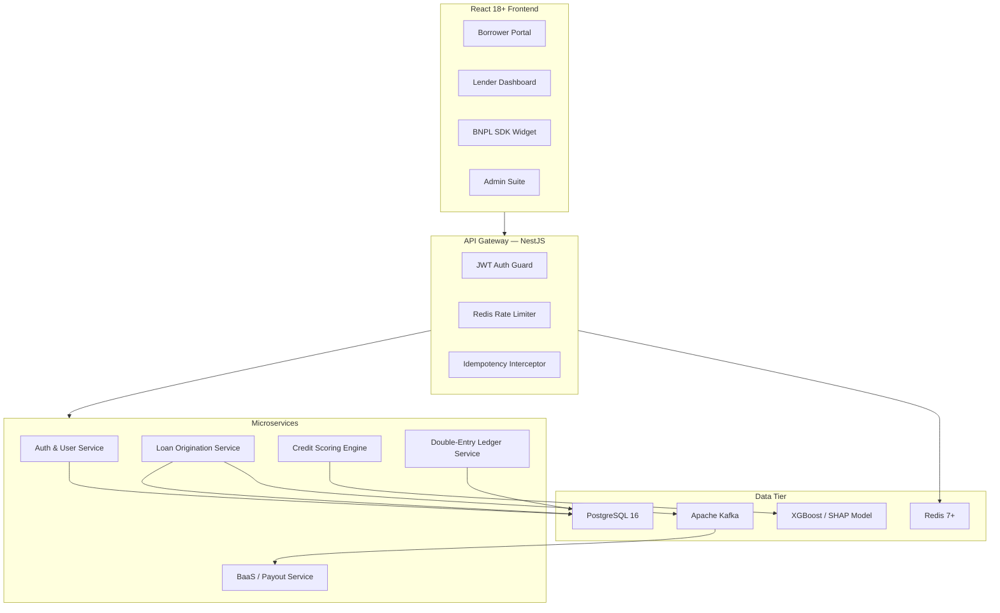

### Tech Stack Summary

| Layer | Technology | Purpose |
|---|---|---|
| Frontend | React 18+ / TypeScript / Vite | SPA with SSR-ready architecture |
| Styling | Tailwind CSS + Shadcn/Radix UI | Premium component library |
| State | Redux Toolkit + TanStack Query | Global + server state management |
| Charts | Recharts | Amortization & yield visualizations |
| Forms | React Hook Form + Zod | Schema-validated financial forms |
| Real-time | Socket.io | Live loan status & notifications |
| HTTP | Axios + interceptors | JWT rotation, idempotency headers |
| Backend | NestJS (Node 20+, TypeScript) | Modular microservices |
| Database | PostgreSQL 16 | ACID-compliant ledger & transactions |
| Cache | Redis 7+ | Rate limiting, sessions, idempotency |
| Events | Apache Kafka / RabbitMQ | Async event streaming |
| ML | Python + XGBoost + SHAP | Credit risk scoring |
| KYC | Persona / Jumio APIs | Identity verification |
| Banking | Stripe Treasury / Unit / Plaid | BaaS integrations |

---

## 2. Feature 1 — Authentication & User Management

### 2.1 How It Works (End-to-End)

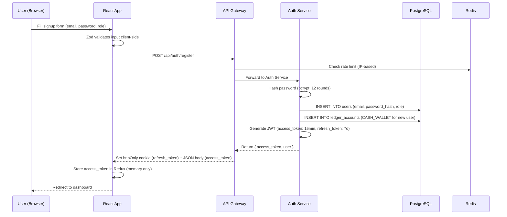

### 2.2 User Roles & Permissions (RBAC)

| Role | Capabilities |
|---|---|
| **BORROWER** | Apply for loans, view repayment schedule, make payments, upload KYC docs |
| **LENDER** | Browse loan marketplace, set auto-bid rules, view portfolio analytics |
| **ADMIN** | Review KYC queue, approve/reject loans, view audit trail, manage users |
| **MERCHANT** | Integrate BNPL SDK, view checkout financing analytics |

### 2.3 Token Lifecycle

1. **Access Token** (JWT, 15 min TTL): Stored in Redux memory. Contains `{ userId, role, email }`. Sent as `Authorization: Bearer <token>` header.
2. **Refresh Token** (opaque, 7 day TTL): Stored in `httpOnly`, `Secure`, `SameSite=Strict` cookie. Used to silently rotate access tokens.
3. **Axios Interceptor Logic**:
   - On `401 Unauthorized` → automatically call `POST /api/auth/refresh` using the httpOnly cookie.
   - On successful refresh → retry the original failed request with the new access token.
   - On refresh failure → dispatch `logout()` action, redirect to `/login`.

### 2.4 Database Records Created on Signup

```sql
-- User record
INSERT INTO users (email, password_hash, role, kyc_status) 
VALUES ('user@example.com', '$2b$12$...', 'BORROWER', 'PENDING');

-- Auto-create CASH_WALLET ledger account
INSERT INTO ledger_accounts (user_id, account_type, balance, currency) 
VALUES ('<user-uuid>', 'CASH_WALLET', 0.00, 'USD');
```

### 2.5 Frontend Components

| Component | Location | Purpose |
|---|---|---|
| `LoginForm` | `features/auth/LoginForm.tsx` | Email/password login with Zod validation |
| `SignupForm` | `features/auth/SignupForm.tsx` | Registration with role selection |
| `MFASetup` | `features/auth/MFASetup.tsx` | TOTP 2FA enrollment (future) |
| `PasswordReset` | `features/auth/PasswordReset.tsx` | Email-based password recovery |
| `useAuth` hook | `hooks/useAuth.ts` | Auth state, login/logout/refresh functions |

### 2.6 Backend Endpoints

| Method | Path | Guard | Description |
|---|---|---|---|
| POST | `/api/auth/register` | Public | Create account + CASH_WALLET |
| POST | `/api/auth/login` | Public | Authenticate, return JWT |
| POST | `/api/auth/refresh` | Cookie | Rotate access token |
| POST | `/api/auth/logout` | JWT | Invalidate refresh token |
| GET | `/api/auth/me` | JWT | Return current user profile |

---

## 3. Feature 2 — KYC / AML Identity Verification

### 3.1 How It Works (End-to-End)

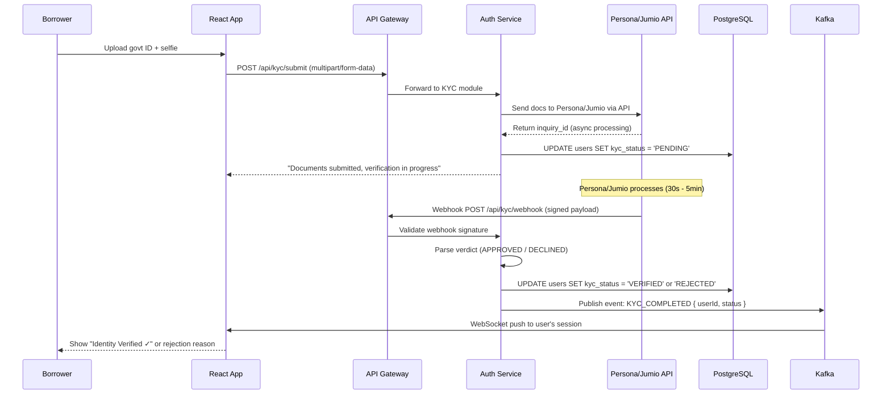

### 3.2 Verification Checks

| Check | Provider | What It Does |
|---|---|---|
| **Document Authenticity** | Persona/Jumio | AI-based parsing of govt ID (passport, driver's license, national ID) — checks for tampering, expiry |
| **Facial Biometrics** | Persona/Jumio | Liveness detection + face match against ID photo |
| **AML Screening** | Persona/Jumio | Real-time screening against PEP lists, OFAC sanctions, global watchlists |
| **Address Verification** | Plaid / utility APIs | Cross-reference declared address with bank statement or utility bill |

### 3.3 KYC State Machine

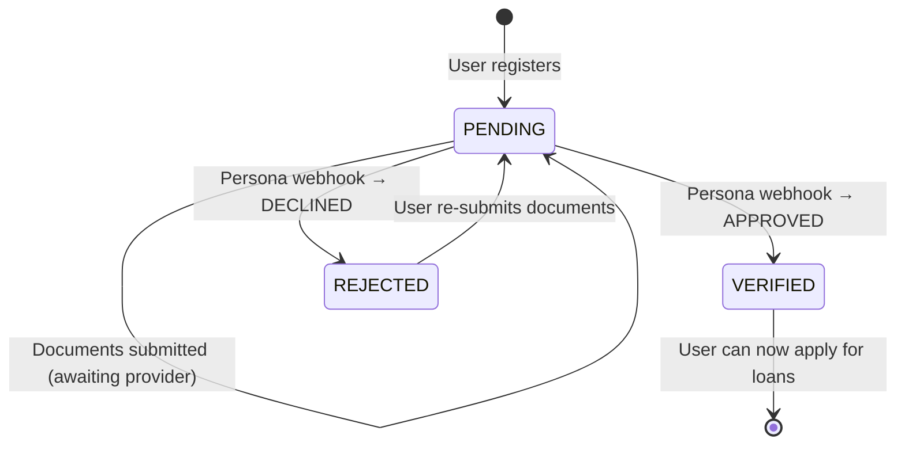

### 3.4 Business Rules

- **Borrowers MUST be KYC-verified** before submitting a loan application.
- **Lenders MUST be KYC-verified** before funding any loan.
- **Rejected users** can re-submit with corrected documents (max 3 attempts).
- **Admin** can manually override KYC status in the compliance suite.
- **All KYC events are immutably logged** in the audit trail.

---

## 4. Feature 3 — AI-Powered Credit Scoring Engine

### 4.1 How It Works (End-to-End)

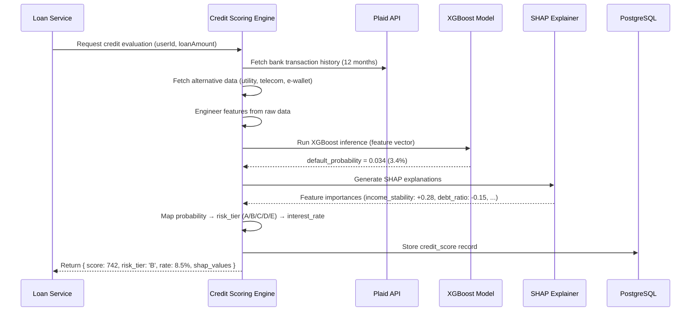

### 4.2 Feature Engineering

| Feature Category | Data Source | Features Extracted |
|---|---|---|
| **Traditional** | User input | Monthly income, employment status, existing debts |
| **Bank Transaction** | Plaid API | Avg monthly balance, income regularity, overdraft frequency, spending categories |
| **Alternative — Telecom** | Telecom API | Account age, payment history, data usage consistency |
| **Alternative — Utility** | Utility API | Payment punctuality, service tenure |
| **Alternative — E-Wallet** | Digital wallet API | Transaction volume, merchant diversity, savings patterns |

### 4.3 Risk Tier → Interest Rate Mapping

| Risk Tier | Default Probability | Interest Rate (APR) | Description |
|---|---|---|---|
| **A** (Prime) | 0–2% | 5.0 – 7.0% | Excellent credit, high income stability |
| **B** (Near-Prime) | 2–5% | 7.0 – 10.0% | Good credit, minor risk factors |
| **C** (Standard) | 5–10% | 10.0 – 15.0% | Moderate risk, limited credit history |
| **D** (Subprime) | 10–20% | 15.0 – 22.0% | Elevated risk, alternative data driven |
| **E** (High Risk) | 20%+ | DECLINED | Too risky, application denied |

### 4.4 SHAP Explainability (Regulatory Compliance)

For every credit decision, the engine produces human-readable explanations:

```
Score: 742 | Risk Tier: B | Approved at 8.5% APR

Top factors influencing your score:
✅ Income stability (regular monthly deposits)     → +0.28
✅ Low existing debt-to-income ratio               → +0.22
✅ 4+ years of utility payment history              → +0.15
⚠️ Limited traditional credit bureau data          → -0.12
⚠️ Recent high spending relative to income         → -0.08
```

This satisfies **FCRA adverse action notice requirements** and **EU GDPR right to explanation**.

### 4.5 Architecture Decision: Python Sidecar vs ONNX

| Approach | When to Use |
|---|---|
| **Python Microservice** (Flask/FastAPI) | Full model, can retrain on-the-fly, SHAP native support. Higher latency (~200ms). |
| **ONNX Runtime Sidecar** (Node.js) | Exported model, faster inference (~20ms), no Python dependency. No native SHAP. |

**Recommendation**: Start with Python microservice for development (SHAP explanations are critical). Optimize with ONNX for production latency later.

---

## 5. Feature 4 — Borrower Portal & Loan Origination

### 5.1 How It Works (End-to-End)

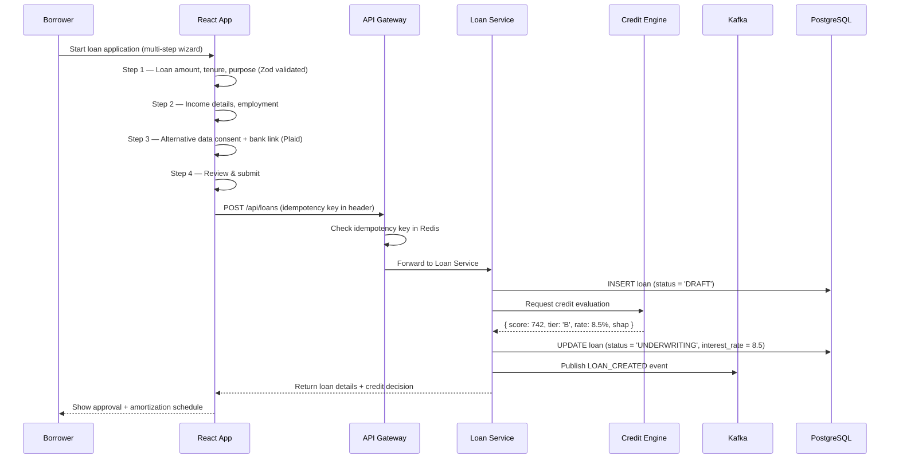

### 5.2 Loan Application Wizard (4 Steps)

| Step | Screen | Fields | Validation |
|---|---|---|---|
| 1 | Loan Details | `principalAmount`, `tenureMonths`, `purpose` | Min $500, max $50K. Tenure: 6/12/24/36/48 months |
| 2 | Income & Employment | `monthlyIncome`, `employmentStatus`, `employer` | Min income $1,000/mo |
| 3 | Data Consent | `acceptAlternativeDataConsent`, Plaid bank link | Consent must be `true` |
| 4 | Review & Submit | Summary of all fields | Final confirmation |

### 5.3 Loan Status State Machine

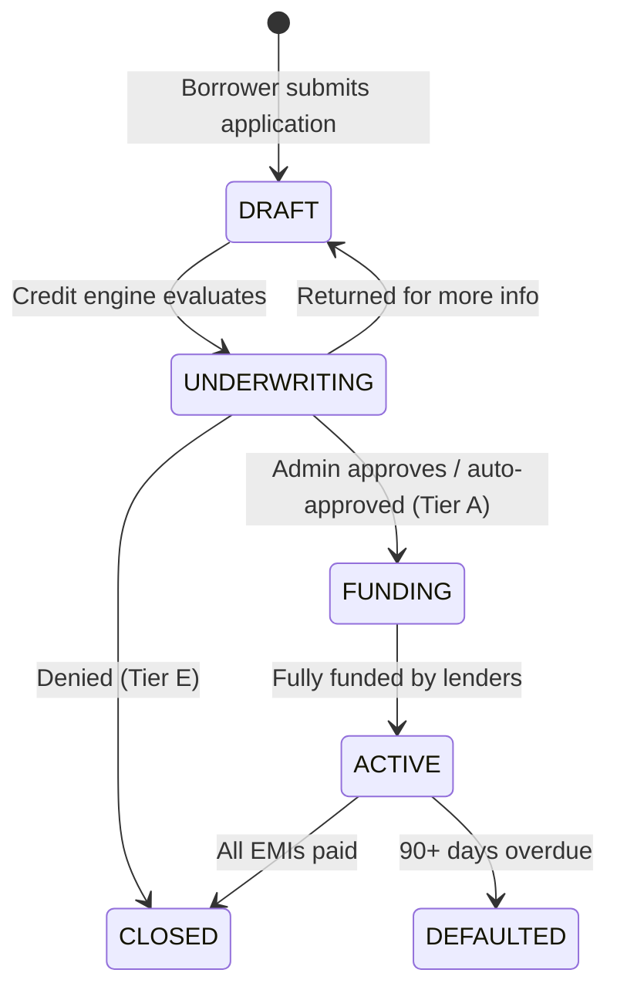

### 5.4 Amortization Schedule Calculation

For a loan of **$10,000 at 8.5% APR for 24 months**:

```
Monthly EMI = P × r × (1+r)^n / ((1+r)^n - 1)
Where: P = 10000, r = 0.085/12 = 0.00708, n = 24

EMI = $454.36/month

Month | EMI     | Principal | Interest | Remaining
  1   | $454.36 | $383.53   | $70.83   | $9,616.47
  2   | $454.36 | $386.25   | $68.12   | $9,230.23
  3   | $454.36 | $388.98   | $65.38   | $8,841.25
 ...  | ...     | ...       | ...      | ...
  24  | $454.36 | $451.16   | $3.20    | $0.00
```

This schedule is:
- **Generated server-side** and stored in DB
- **Rendered client-side** as an interactive Recharts AreaChart
- **Updated in real-time** as repayments are made

### 5.5 Frontend Components

| Component | Purpose |
|---|---|
| `LoanWizard` | 4-step form orchestrator |
| `LoanDetailsStep` | Amount, tenure, purpose fields |
| `IncomeStep` | Income & employment details |
| `ConsentStep` | Alternative data consent + Plaid Link |
| `ReviewStep` | Summary before submission |
| `RepaymentChart` | Recharts amortization visualization |
| `ActiveLoansTable` | DataTable of all borrower's loans |
| `EMIPaymentModal` | One-click EMI payment interface |

### 5.6 Backend Endpoints

| Method | Path | Guard | Description |
|---|---|---|---|
| POST | `/api/loans` | JWT + KYC_VERIFIED | Create loan application |
| GET | `/api/loans` | JWT | List user's loans |
| GET | `/api/loans/:id` | JWT | Loan detail + amortization |
| GET | `/api/loans/:id/schedule` | JWT | Full amortization table |
| POST | `/api/loans/:id/repay` | JWT + Idempotency | Make EMI payment |

---

## 6. Feature 5 — Lender / Investor Marketplace

### 6.1 How It Works (End-to-End)

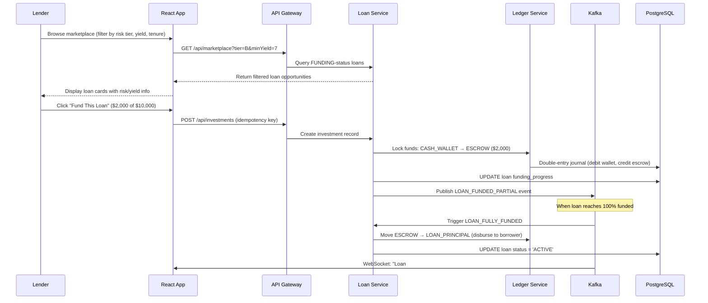

### 6.2 Marketplace Features

| Feature | How It Works |
|---|---|
| **Loan Browser** | Filterable grid: risk tier (A-D), yield %, tenure, amount needed, % funded |
| **Risk Visualization** | Each loan card shows SHAP-derived risk summary, credit score, and default probability |
| **Partial Funding** | Lenders can fund any fraction of a loan (min $100). Multiple lenders can co-fund |
| **Auto-Bid Rules** | Lender sets rules: "Auto-invest up to $5,000 in Tier A-B loans, 12-24 month tenure" |
| **Portfolio Dashboard** | Aggregate view: total invested, weighted avg yield, default rate, monthly returns |

### 6.3 Auto-Bid Engine

```
Rule: {
  maxInvestmentPerLoan: $5000,
  totalBudget: $50000,
  riskTiers: ['A', 'B'],
  tenureRange: [6, 24],
  minYield: 7.0
}

When a new FUNDING-status loan matches → automatically create investment.
Runs as a Kafka consumer: listens for LOAN_CREATED events → evaluates rules → invests.
```

### 6.4 Yield Calculation

For a lender who funded $2,000 of a $10,000 loan at 8.5% APR for 24 months:

```
Lender's share: 20% of loan
Monthly return: 20% × $454.36 EMI = $90.87
  - Principal return: 20% × principal_component
  - Interest income: 20% × interest_component
Total interest earned over 24 months: ~$908.72
Net Yield: ~8.5% APR (minus platform fee of ~1%)
Effective Yield: ~7.5% APR
```

### 6.5 Frontend Components

| Component | Purpose |
|---|---|
| `MarketplaceGrid` | Filterable, sortable loan opportunity browser |
| `LoanCard` | Individual loan opportunity with risk/yield summary |
| `FundLoanModal` | Investment amount input + confirmation |
| `AutoBidRuleForm` | Rule builder for automated investing |
| `PortfolioDashboard` | Aggregate investment analytics |
| `YieldChart` | Monthly returns visualization |
| `DefaultMetrics` | Portfolio default rate tracking |

---

## 7. Feature 6 — Double-Entry Financial Ledger

### 7.1 How It Works

> [!CAUTION]
> This is the **financial core** of the platform. Every cent moving through the system is tracked as a pair of debit/credit entries. **No money can appear or disappear** — the ledger must always balance to zero.

### 7.2 Account Types

| Account Type | Purpose | Normal Balance |
|---|---|---|
| `CASH_WALLET` | User's available balance (borrower or lender) | Debit (Asset) |
| `ESCROW` | Locked funds during loan funding period | Debit (Asset) |
| `LOAN_PRINCIPAL` | Outstanding loan principal | Debit (Asset) |
| `INTEREST_REVENUE` | Platform's earned interest/fees | Credit (Revenue) |

### 7.3 Transaction Flows (Journal Entries)

#### Flow A: Lender Deposits Funds
```
DEBIT  lender.CASH_WALLET     +$10,000  (lender's wallet increases)
CREDIT platform.CASH_INFLOW   -$10,000  (external source)
```

#### Flow B: Lender Funds a Loan
```
DEBIT  loan.ESCROW             +$2,000  (money locked in escrow)
CREDIT lender.CASH_WALLET      -$2,000  (deducted from lender's wallet)
```

#### Flow C: Loan Disbursement (100% funded)
```
DEBIT  borrower.CASH_WALLET   +$10,000  (borrower receives money)
CREDIT loan.ESCROW             -$10,000  (escrow released)
```

#### Flow D: Borrower Makes EMI Payment
```
DEBIT  loan.LOAN_PRINCIPAL     -$383.53  (principal portion reduces outstanding)
CREDIT borrower.CASH_WALLET    -$454.36  (deducted from borrower)
DEBIT  platform.INTEREST_REVENUE +$70.83  (interest goes to platform/lenders)
```

#### Flow E: Reversal / Refund (Compensating Entry)
```
-- Original entries are NEVER deleted. A reversal posts opposite entries:
DEBIT  lender.CASH_WALLET      +$2,000  (money returned)
CREDIT loan.ESCROW              -$2,000  (escrow released back)
```

### 7.4 Implementation: Serializable Isolation

Every ledger operation uses PostgreSQL `SERIALIZABLE` isolation + `FOR UPDATE` row locks:

```typescript
// Pseudocode for the critical section
await queryRunner.startTransaction('SERIALIZABLE');
const account = await query('SELECT balance FROM ledger_accounts WHERE id = $1 FOR UPDATE', [id]);
if (account.balance < amount) throw new InsufficientFundsError();
await query('UPDATE ledger_accounts SET balance = balance - $1 WHERE id = $2', [amount, id]);
await query('UPDATE ledger_accounts SET balance = balance + $1 WHERE id = $2', [amount, toId]);
await query('INSERT INTO journal_entries (...) VALUES (...)', [...]);
await queryRunner.commitTransaction();
```

### 7.5 Ledger Invariant

At any point in time:
```
SUM(all DEBIT entries) === SUM(all CREDIT entries)
```
A scheduled job validates this invariant daily. Any imbalance triggers a **CRITICAL** alert.

---

## 8. Feature 7 — Embedded BNPL / Checkout SDK

### 8.1 How It Works (End-to-End)

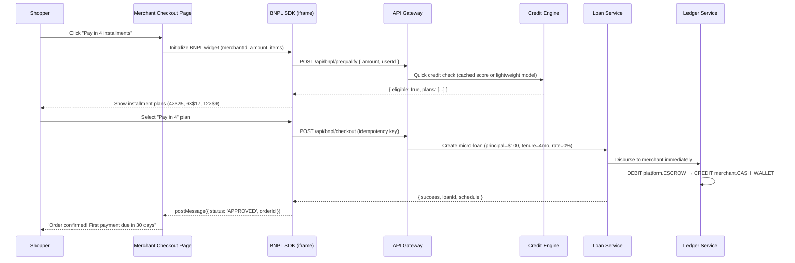

### 8.2 SDK Integration (Merchant Side)

```html
<!-- Merchant adds this to their checkout page -->
<script src="https://sdk.lendingplatform.com/bnpl.js"></script>
<script>
  LendingBNPL.init({
    merchantId: 'merch_abc123',
    amount: 99.99,
    currency: 'USD',
    container: '#bnpl-widget',
    onApproved: (result) => { /* complete order */ },
    onDeclined: (reason) => { /* show alternative payment */ }
  });
</script>
```

### 8.3 Installment Plan Options

| Plan | Payments | Interest | Use Case |
|---|---|---|---|
| **Pay in 4** | 4 biweekly | 0% APR | Purchases $50–$500 |
| **Pay in 6** | 6 monthly | 0% APR | Purchases $100–$1,000 |
| **Pay in 12** | 12 monthly | 5–10% APR | Purchases $500–$5,000 |

### 8.4 Frontend Components

| Component | Purpose |
|---|---|
| `BNPLWidget` | Embeddable React component (renders in iframe) |
| `PlanSelector` | Radio group showing available installment plans |
| `PrequalResult` | Approval/decline status with plan details |
| `InstallmentTimeline` | Visual timeline of upcoming payments |

---

## 9. Feature 8 — Admin & Compliance Suite

### 9.1 How It Works

The Admin Suite is accessible only to `ADMIN` role users and provides operational control over the entire platform.

### 9.2 Sub-Features

#### A. Underwriting Queue

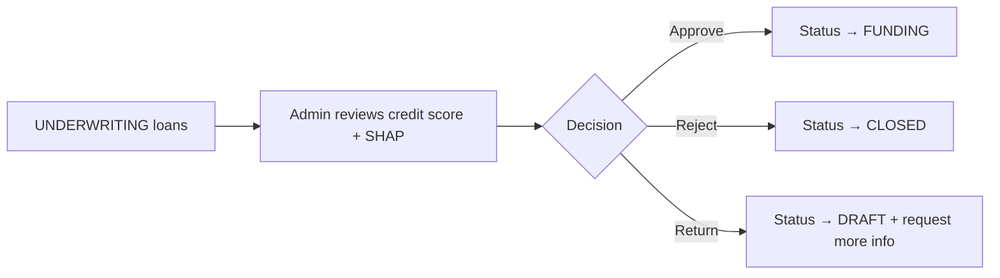

- Shows all loans in `UNDERWRITING` status
- Displays: borrower profile, credit score, SHAP feature importances (bar chart), loan details
- Admin can **approve** (auto for Tier A), **reject** (with reason), or **return for more info**
- **Tier A loans** are auto-approved (no admin intervention needed)

#### B. KYC/AML Exception Management

- Queue of pending KYC verifications
- Manual review of documents flagged by Persona/Jumio
- Override capability (approve/reject with audit note)
- View full verification history per user

#### C. Audit Trail Viewer

- Immutable log of every action: login, KYC change, loan state change, ledger entry, admin action
- Filterable by user, action type, date range
- Exportable as CSV/PDF for compliance reporting
- **Cannot be edited or deleted** (append-only)

#### D. Platform Analytics Dashboard

| Metric | Visualization |
|---|---|
| Total loans originated | KPI card + trend line |
| Default rate | Gauge chart + historical trend |
| Average credit score | Distribution histogram |
| Funding velocity | Time-to-fund trend line |
| Revenue (interest + fees) | Monthly bar chart |
| Active users by role | Donut chart |

### 9.3 Frontend Components

| Component | Purpose |
|---|---|
| `UnderwritingQueue` | Sortable table of pending loans |
| `CreditReviewPanel` | Detailed credit analysis with SHAP chart |
| `KYCReviewQueue` | Manual identity verification queue |
| `AuditTrailTable` | Filterable, searchable audit log |
| `PlatformAnalytics` | Admin dashboard with KPI cards + charts |
| `UserManagement` | Search, view, suspend user accounts |

---

## 10. Feature 9 — Real-Time Notifications & WebSockets

### 10.1 How It Works

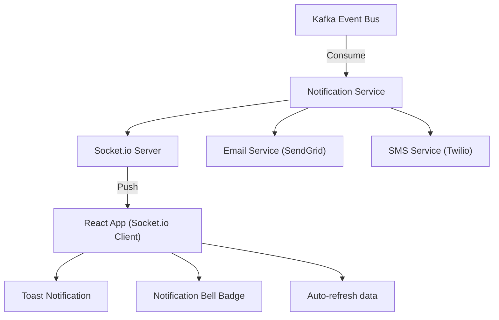

### 10.2 Event → Notification Mapping

| Kafka Event | WebSocket Push | Email | SMS |
|---|---|---|---|
| `KYC_COMPLETED` | ✅ "Identity verified!" | ✅ | ❌ |
| `LOAN_CREATED` | ✅ "Application received" | ✅ | ❌ |
| `LOAN_APPROVED` | ✅ "Loan approved!" | ✅ | ✅ |
| `LOAN_FUNDED_PARTIAL` | ✅ "Loan 40% funded" | ❌ | ❌ |
| `LOAN_FULLY_FUNDED` | ✅ "Loan disbursed!" | ✅ | ✅ |
| `EMI_DUE_REMINDER` | ✅ "EMI due in 3 days" | ✅ | ✅ |
| `EMI_PAID` | ✅ "Payment received" | ✅ | ❌ |
| `LOAN_DEFAULTED` | ✅ "Account overdue" | ✅ | ✅ |
| `INVESTMENT_RETURN` | ✅ "Monthly return credited" | ✅ | ❌ |

### 10.3 Frontend Hook

```typescript
// hooks/useWebSocket.ts
const useWebSocket = (userId: string) => {
  useEffect(() => {
    const socket = io(WS_URL, { auth: { token: accessToken } });
    socket.on(`notification:${userId}`, (data) => {
      dispatch(addNotification(data));
      showToast(data.message, data.type);
    });
    return () => socket.disconnect();
  }, [userId]);
};
```

---

## 11. Feature 10 — Idempotency & Transaction Safety

### 11.1 Why It's Critical

In financial systems, **duplicate transactions are catastrophic**. Network retries, user double-clicks, and timeout-retransmissions can all cause:
- Double loan disbursements
- Duplicate EMI charges
- Double investment commitments

### 11.2 How It Works

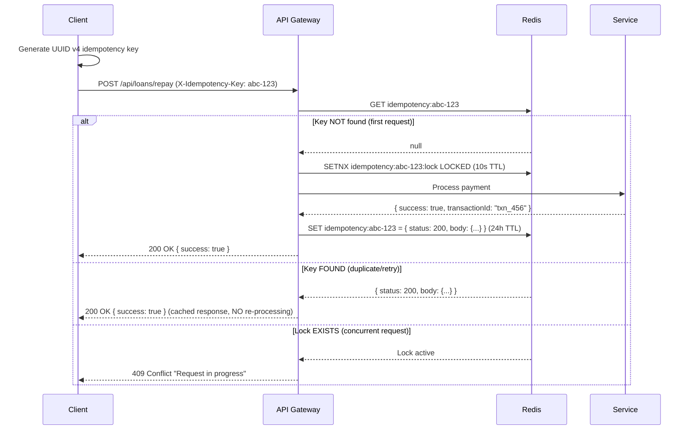

### 11.3 Client-Side Implementation

```typescript
// Every financial mutation button generates a unique key
const handlePayEMI = async () => {
  const idempotencyKey = uuidv4(); // Generated ONCE per user action
  await axios.post('/api/loans/repay', payload, {
    headers: { 'X-Idempotency-Key': idempotencyKey }
  });
};
```

### 11.4 Idempotent Endpoints

| Endpoint | Why Idempotent |
|---|---|
| `POST /api/loans` | Prevent duplicate loan applications |
| `POST /api/loans/:id/repay` | Prevent double EMI charges |
| `POST /api/investments` | Prevent double funding commitments |
| `POST /api/bnpl/checkout` | Prevent duplicate BNPL orders |
| `POST /api/ledger/transfer` | Prevent double-entry duplication |

---

## 12. Cross-Cutting Concerns

### 12.1 API Rate Limiting

| Tier | Limit | Window | Scope |
|---|---|---|---|
| Public endpoints | 20 req | 1 min | Per IP |
| Authenticated users | 100 req | 1 min | Per user |
| Admin users | 500 req | 1 min | Per user |
| BNPL SDK | 50 req | 1 min | Per merchant |

Implemented via Redis sliding window counters in the API Gateway.

### 12.2 Error Handling Strategy

```typescript
// Standardized API response wrapper
interface ApiResponse<T> {
  success: boolean;
  data?: T;
  error?: {
    code: string;        // e.g., "INSUFFICIENT_FUNDS"
    message: string;     // Human-readable message
    details?: any;       // Validation errors, field-level
  };
  meta?: {
    requestId: string;   // For tracing
    timestamp: string;
  };
}
```

### 12.3 Logging & Observability

| Tool | Purpose |
|---|---|
| **Winston / Pino** | Structured JSON logging (NestJS) |
| **Prometheus** | Metrics scraping (request latency, error rates, queue depth) |
| **OpenTelemetry** | Distributed tracing across microservices |
| **Grafana** | Dashboards for all metrics |
| **ELK Stack** | Log aggregation and search |

### 12.4 Security Checklist

- [x] JWT with short TTL (15 min) + httpOnly refresh cookies
- [x] bcrypt password hashing (12 salt rounds)
- [x] Rate limiting on all endpoints
- [x] CORS restricted to allowed origins
- [x] Helmet.js security headers
- [x] Input validation (Zod client, class-validator server)
- [x] SQL injection prevention (parameterized queries via ORM)
- [x] XSS prevention (React auto-escaping + CSP headers)
- [x] mTLS between microservices
- [x] PII field-level encryption (AES-256)
- [x] Audit trail immutability

---

## 13. Database Schema Relationships

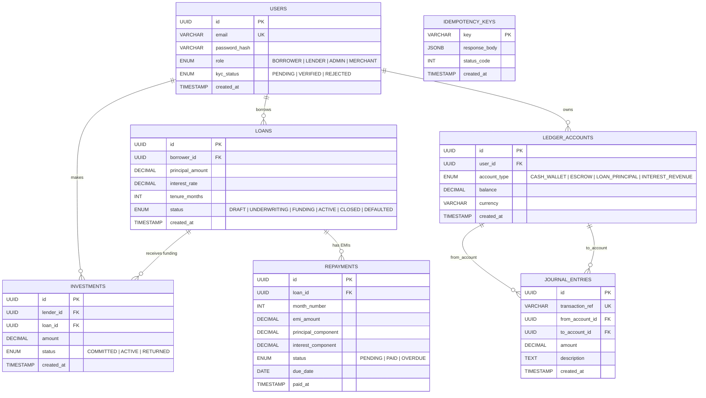

> [!NOTE]
> The `INVESTMENTS` and `REPAYMENTS` tables are **additional tables not in the original spec** but are required for the marketplace and repayment tracking features to work. They will be added during implementation.

---

## 14. Event-Driven Architecture (Kafka)

### 14.1 Kafka Topics

| Topic | Producer | Consumers | Purpose |
|---|---|---|---|
| `kyc.events` | Auth Service | Notification Service, Loan Service | KYC status changes |
| `loan.events` | Loan Service | Marketplace, Notification, Ledger | Loan lifecycle events |
| `investment.events` | Loan Service | Ledger, Notification, Portfolio | Investment actions |
| `payment.events` | Ledger Service | Notification, Analytics, Loan Service | EMI payments |
| `bnpl.events` | BNPL Service | Ledger, Merchant Webhook, Notification | Checkout financing |

### 14.2 Event Schema (Example)

```typescript
interface LoanEvent {
  eventId: string;          // UUID
  eventType: 'LOAN_CREATED' | 'LOAN_APPROVED' | 'LOAN_FUNDED' | 'LOAN_ACTIVE' | 'LOAN_DEFAULTED';
  timestamp: string;        // ISO 8601
  payload: {
    loanId: string;
    borrowerId: string;
    amount: number;
    status: string;
    metadata?: Record<string, any>;
  };
}
```

### 14.3 Event Flow Diagram

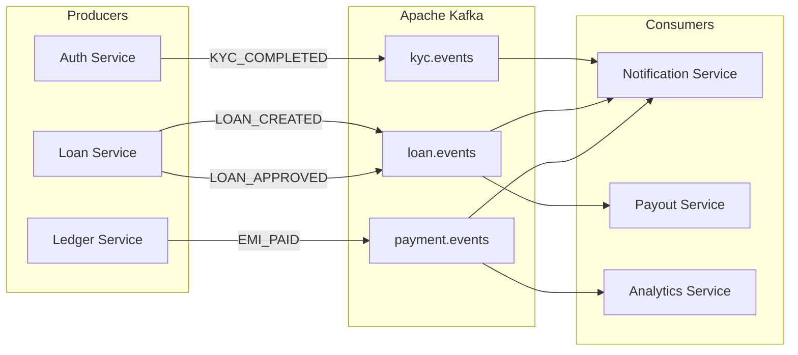

---

## 15. Implementation Execution Plan

### Phase 1 — Foundation (Week 1-2)
| Task | Details |
|---|---|
| Project scaffolding | NestJS backend + Vite React frontend |
| Database setup | PostgreSQL schema, Prisma ORM, migrations |
| Auth module | Register, login, JWT, refresh, RBAC guards |
| Redis setup | Rate limiting, session store |
| Base UI | Layout, navbar, sidebar, design system (Tailwind + Shadcn) |
| API client | Axios instance with interceptors |

### Phase 2 — Core Features (Week 3-5)
| Task | Details |
|---|---|
| KYC module | Document upload, webhook handler, status tracking |
| Loan origination | Multi-step wizard, Zod validation, CRUD APIs |
| Credit scoring | Python microservice, XGBoost model, SHAP explanations |
| Double-entry ledger | Serializable transactions, journal entries, balance checks |
| Amortization engine | EMI calculation, schedule generation, Recharts visualization |

### Phase 3 — Marketplace & Payments (Week 6-8)
| Task | Details |
|---|---|
| Lender marketplace | Loan browser, filtering, funding flow |
| Investment management | Portfolio dashboard, yield tracking |
| Auto-bid engine | Rule builder UI, Kafka consumer for matching |
| EMI payments | Payment processing, ledger entries, status updates |
| Kafka event bus | Topic setup, producers, consumers |

### Phase 4 — Advanced Features (Week 9-11)
| Task | Details |
|---|---|
| BNPL SDK | Embeddable widget, prequalification, checkout flow |
| Admin suite | Underwriting queue, KYC review, audit trail |
| Real-time notifications | Socket.io, toast notifications, notification center |
| Platform analytics | Admin dashboard, KPI cards, charts |

### Phase 5 — Polish & Production (Week 12-14)
| Task | Details |
|---|---|
| Security hardening | mTLS, PII encryption, penetration testing |
| Performance optimization | Query optimization, caching, lazy loading |
| Testing | Unit tests, integration tests, E2E tests |
| CI/CD | Docker, Kubernetes, GitHub Actions |
| Documentation | API docs (Swagger), user guides |

---

> [!TIP]
> This is a **massive project**. I recommend starting with **Phase 1** and building incrementally. Each phase delivers a working, testable slice of functionality. Would you like me to begin with the project scaffolding and foundation?
